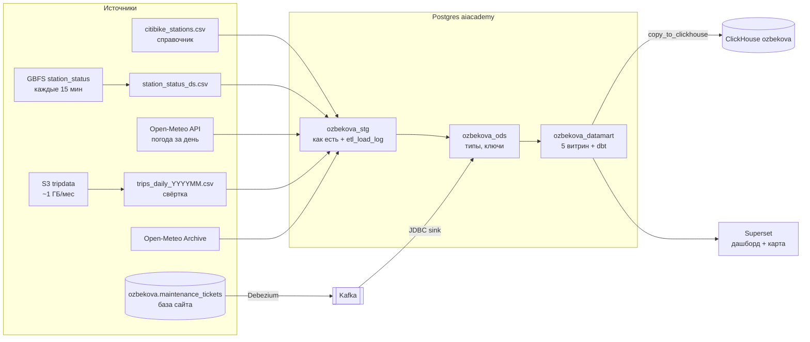

# Финальный проект ozbekova — Citi Bike + погода

Мини-хранилище: снимки станций Citi Bike (GBFS) и справочник станций из CSV, погода из API
Open-Meteo → Postgres `stg → ods → datamart` → копия витрины в ClickHouse; заявки на ремонт
станций приходят через CDC (Debezium + Kafka). Подробно: [docs/data_model.md](docs/data_model.md),
источники: [docs/dataset_passport.md](docs/dataset_passport.md).

```
~/work/dags/project/
├── dag/    final_ozbekova_{pipeline,datamart,collector,history}_dag.py, ozbekova_common.py
├── data/   citibike_stations.csv, station_status/station_status_YYYY-MM-DD.csv, trips/trips_daily_YYYYMM.csv
├── sql/    01_ddl_postgres.sql, 02_ddl_clickhouse.sql, ods_*.sql, dm_*.sql
├── dbt/    модели dm_daily_station_activity_dbt, dm_rain_impact_dbt + 37 тестов
├── cdc/    01_site_db.sql, коннекторы *.json, deploy.sh
├── demo/   demo_defense.ipynb — живое демо для защиты
└── docs/   dataset_passport.md, data_model.md
```

| DAG | Что делает |
|-----|-----------|
| `final_ozbekova_collector` | каждые 15 мин скачивает GBFS `station_status` и дописывает снимок в CSV за день |
| `final_ozbekova_pipeline` | за `ds`: CSV + API → `stg_*` → `ods_*` → запускает DAG витрин с той же датой |
| `final_ozbekova_datamart` | `dm_daily_station_activity`, `dm_station_size_monthly`, `dm_hourly_station_state`, `dm_station_daily` → `dq_checks` → ClickHouse |
| `final_ozbekova_history` | помесячно (catchup июль–сентябрь 2026): архив поездок S3 + архив погоды → `stg` → `ods` → `dm_weather_trips_daily` → `dq_history` |

На стенде DAG создаются через обёртку `student_dag` (`_lib.tenant`), она добавляет к dag_id префикс `ozbekova.`.

## Архитектура



Оркестрация — Airflow: `collector` (15 мин) → `pipeline` (02:00 NY) → `datamart` (триггер);
`history` (помесячно, catchup). Проверки — `dq_checks` (15), `dq_history` (6) и dbt-тесты.

Пароли нигде в проекте не записаны: только Airflow Connections и переменные окружения.

## Запуск с нуля

### 0. Переменные окружения (в своём терминале, не в файлах)

```bash
export PG_HOST=<хост postgres> PG_PORT=5432 PG_USER=ozbekova
read -s PG_PASS && export PG_PASS          # ввести пароль, на экран не выводится
export CONNECT_URL=http://kafka-connect:8083
```

### 1. Схемы и таблицы

```bash
cd ~/work/dags/project
PGPASSWORD=$PG_PASS psql -h $PG_HOST -p $PG_PORT -U $PG_USER -d aiacademy -f sql/01_ddl_postgres.sql
PGPASSWORD=$PG_PASS psql -h $PG_HOST -p $PG_PORT -U $PG_USER -d aiacademy -f cdc/01_site_db.sql
```

### 2. Airflow Connections

```bash
airflow connections add aiacademy_pg_ozbekova --conn-type postgres \
  --conn-host $PG_HOST --conn-port $PG_PORT --conn-schema aiacademy \
  --conn-login $PG_USER --conn-password "$PG_PASS"

airflow connections add ch_ozbekova --conn-type http \
  --conn-host <хост clickhouse> --conn-port 8123 --conn-schema http \
  --conn-login <пользователь clickhouse> --conn-password "$CH_PASS"
```

(Или то же через UI: Admin → Connections.) База и таблица в ClickHouse создаются задачей
`copy_to_clickhouse` автоматически (`sql/02_ddl_clickhouse.sql`).

### 3. Сбор снимков

Включить DAG `final_ozbekova_collector` (Unpause). Через 15 минут появится
`data/station_status/station_status_<сегодня>.csv`. Полный день данных — после полуночи по Нью-Йорку.
Загрузить можно только ту дату, за которую уже есть файл.

### 4. CDC

```bash
bash cdc/deploy.sh      # создаёт maintenance_tickets-source-ozbekova и sink-ozbekova, печатает статусы
```

### 5. dbt

```bash
cd ~/work/dags/project/dbt
export DBT_PG_HOST=$PG_HOST DBT_PG_PORT=$PG_PORT DBT_PG_USER=$PG_USER DBT_PG_PASS=$PG_PASS
dbt debug --profiles-dir .
```

### 6. Запуск за дату

Airflow UI → `final_ozbekova_pipeline` → Trigger DAG w/ config → Logical date = нужный день
(за который есть файл в `data/station_status/`). DAG витрин запустится сам.

История: включить `final_ozbekova_history` — Airflow сам создаст запуски за июль, август и сентябрь
(~4 минуты на месяц: скачивание архива ~1 ГБ). Следующие месяцы — продлить `end_date` в DAG.

### 7. Демо и документация dbt

- `demo/demo_defense.ipynb` — живое демо в JupyterLab: CDC (статус заявки доходит до ods за секунды),
  идемпотентность (Clear в Airflow — число строк не меняется), ответ про дождь одним запросом,
  журнал `etl_load_log`, копия в ClickHouse. Пароли берутся из окружения стенда и не печатаются.
- `dbt docs generate --static --profiles-dir .` → `dbt/target/static_index.html`; в JupyterLab:
  правый клик → Open in New Browser Tab, граф происхождения данных — кнопка справа внизу.

## Проверки по критериям приёмки

```sql
-- ФТ-2: строк за дату = строк в файле (wc -l файла минус заголовок)
select count(*), min(_source_file), min(_loaded_at) from ozbekova_stg.stg_station_status where _ds = '2026-10-20';
-- ФТ-3
\d ozbekova_ods.ods_station_status
-- ФТ-4
select * from ozbekova_stg.etl_load_log order by id desc limit 15;
-- ФТ-5: вопросы и сверка — docs/data_model.md
-- ФТ-7: сравнить с ClickHouse:  select sum(empty_snapshots) from ozbekova.dm_daily_station_activity;
select sum(empty_snapshots) from ozbekova_datamart.dm_daily_station_activity;
-- НФТ-1: запустить дату дважды (Clear) и сравнить
select 'stg_status', count(*) from ozbekova_stg.stg_station_status union all
select 'ods_status', count(*) from ozbekova_ods.ods_station_status union all
select 'ods_weather', count(*) from ozbekova_ods.ods_weather union all
select 'dm_daily', count(*) from ozbekova_datamart.dm_daily_station_activity union all
select 'dm_monthly', count(*) from ozbekova_datamart.dm_station_size_monthly;
```

```bash
wc -l data/station_status/station_status_2026-10-20.csv                  # ФТ-2
cd dbt && dbt build --profiles-dir . -s dm_daily_station_activity_dbt    # ФТ-8 (+ тест совпадения с витриной DAG)
dbt test --profiles-dir . -s source:ods                                   # ФТ-10 через dbt
grep -rin "password" .                                                    # НФТ-2: только имена параметров, без значений
```

**ФТ-9 (CDC):**
```sql
update ozbekova.maintenance_tickets set status = 'closed', updated_at = now() where ticket_id = 1;
-- через ≤ 30 секунд:
select * from ozbekova_ods.ods_maintenance_tickets where ticket_id = 1;
```
`curl $CONNECT_URL/connectors/sink-ozbekova/status` → `RUNNING`.

**ФТ-10 (испортить данные):**
```sql
update ozbekova.maintenance_tickets set status = 'broken' where ticket_id = 2;   -- придёт через CDC
```
Clear задачи `dq_checks` → красная, в логе `[FAIL] ods_maintenance_tickets.status accepted_values`.
Вернуть `status = 'in_progress'` → Clear → зелёная.

**НФТ-4 (API недоступен):** Admin → Variables → `ozbekova_weather_api_url` = `http://no-such-host.invalid/v1/forecast`,
Clear `stg_weather` → красная после повторов, в `stg_weather` за дату ничего не изменилось
(запись в базу только после полного успешного ответа). После проверки переменную удалить.
